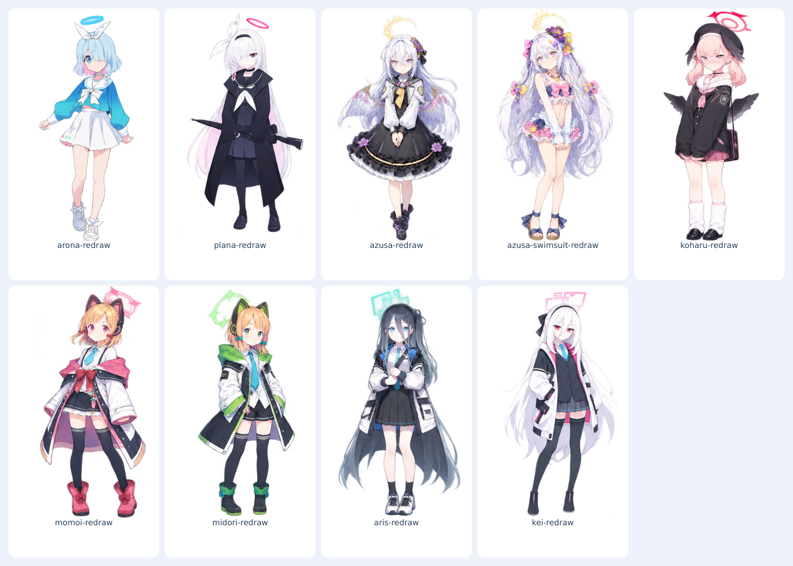

# AronaBox

**阿罗娜桌宠 · 桌面助手 · 非商业使用**

一个 Windows 桌面助手：让阿罗娜陪你聊天、管理待办、使用本地终端，闲暇时也可以玩小游戏。项目提供源码，角色形象是基于《蔚蓝档案》角色设定创作的非官方二创。

[下载与启动](#下载与启动) · [主要功能](#主要功能) · [使用许可](#使用许可) · [完整使用说明与版本记录](HISTORY.md)

## 当前版本：2.7.1

- 终端支持复制、粘贴、全选、清屏、滚动到底部和字号调整；常用终端快捷键保持兼容。
- 提供 35 套内置皮肤，包含 Q 版、立绘与重绘风格；切换皮肤时同步角色名称。
- 源码已公开；目前没有提供预编译的 Windows 安装包，需要在 Windows 上从源码启动或自行编译。

详细变更、原有功能说明和各版本验证记录见 [完整使用说明与版本记录](HISTORY.md)。

## 下载与启动

1. 在仓库页面选择 **Code → Download ZIP**，解压完整目录；也可以克隆本仓库。版本发布信息请查看 [Releases](https://github.com/ARISAKAHIKARI/AronaBox/releases)。
2. 在 Windows x64 上双击 `start.cmd` 启动；脚本会检查并按需准备 Node.js、Electron 和项目依赖。也可先运行 `install.cmd`。
3. 需要自行编译时，运行 `build-win.cmd`：选择 **1 内网**或 **2 公网**。内网方式输出完整 Windows ZIP，解压后运行 `AronaDesk.exe` 并保留同目录文件；公网方式生成便携版 EXE。已满足要求的依赖会优先复用。
4. 使用本地助手时，在设置中选择 Claude Code 或已安装的兼容 CodeAgent，并按需要配置账号或 API。具体能力取决于实际安装的 CLI 和服务。

内网环境需要可用的公司 npm 源；没有 Node.js 24 或更高版本时，内网构建请先自行安装。网络镜像、证书、代理及故障处理见 [Windows 安装与启动](HISTORY.md#windows-安装与启动)。

## 主要功能

- **桌宠与个性化**：多角色皮肤、表情动作、待机动画、自定义图片和本地 MMD 模型。
- **聊天与终端**：本地 Claude Code / CodeAgent；支持内置网页或连接 Edge 中已登录的 ChatGPT、Gemini、豆包、DeepSeek 网页。网页适配受服务页面变化影响。
- **桌面工具**：待办、便签、截图、文件发送、Markdown 展示及组件管理。
- **语音**：可选本地 GPT-SoVITS 角色语音，需要另行准备兼容的 NVIDIA CUDA 环境及模型；默认关闭。
- **小游戏**：内置扫雷、2048 和太空弹球；外置游戏自行添加，游戏文件不打包在程序中。

外部 CodeAgent Desktop、私有 MMD 模型、外置游戏和角色语音权重需自行准备，具体参见 [完整使用说明](HISTORY.md) 与 [第三方游戏接入](第三方游戏接入.md)。

## 使用许可

AronaBox 中项目权利人有权授权的代码及其他内容采用 [AronaBox Noncommercial License 1.0](LICENSE)：**仅授权非商业目的的使用、修改与分享，不授权商业使用或商业分发**。复制或分享时请保留许可文本及所需声明。具体范围和条件以许可证原文为准。

这是项目专用的非商业许可；由于限制商业使用，项目属于**源码可用**，不符合开放源代码促进会的开源许可定义。

第三方软件仍按各自原许可使用；《蔚蓝档案》角色及相关素材、参考图、语音模型的权利归各自权利人所有，项目许可不授予其额外权利。仓库中的参考图分发授权尚待核实。详见 [第三方组件与素材说明](THIRD_PARTY_NOTICES.md)。
